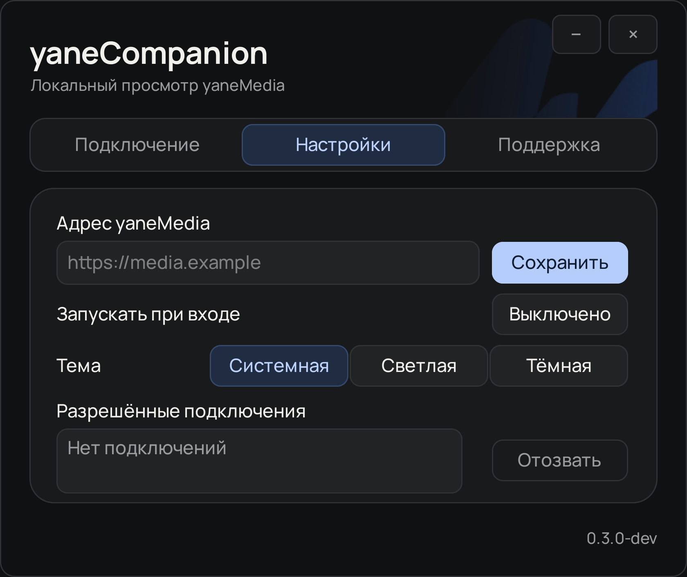

  

<h1 align="center">yaneCompanion</h1>

Приложение для просмотра торрентов в yaneMedia.

yaneCompanion загружает раздачу на вашем компьютере и передаёт видео в плеер
в браузере. TorrServer и FFmpeg входят в установочный пакет.

## Скачать

Пакеты для Windows и Linux публикуются в
[GitHub Releases](https://github.com/Yaneart/yaneCompanion/releases).

| Платформа x64 | Как установить |
| --- | --- |
| Windows 10 2004 и новее, Windows 11 | Откройте скачанный `.exe` и пройдите шаги мастера |
| Debian 12, Ubuntu 24.04 | Откройте скачанный `.deb` в пакетном менеджере или выполните `sudo apt install ./yanecompanion_0.3.1_amd64.deb` в папке загрузок |
| Arch Linux | В папке загрузок выполните `sudo pacman -U ./yanecompanion-bin-0.3.1-1-x86_64.pkg.tar.zst` |

Имена файлов в командах относятся к версии 0.3.1. Для другой версии используйте
имя скачанного файла.

## Первый запуск

- **Windows** — откройте **Пуск** и найдите **Yane**.
- **Linux** — после установки `.deb` или `.pkg.tar.zst` откройте меню приложений
  и найдите **yaneCompanion**. Из терминала программу можно запустить командой
  `yanecompanion` от своего пользователя.

## Подключить к yaneMedia

1. Откройте торрент на yaneMedia и нажмите **Подключить yaneCompanion**. Если браузер
   запросит доступ к локальной сети, разрешите его.
2. Сравните адрес сайта и шестизначный код в браузере и приложении. Нажмите
   **Разрешить** в yaneCompanion. Просмотр продолжится в браузере.

В приложении можно проверить обновления, посмотреть диагностику и отозвать доступ
сайта в настройках.

  

## Документация

- [Установка, обновление, откат и удаление](docs/installation.md)
- [Результаты проверок по платформам](docs/verification.md)
- [Подготовка и публикация релиза](docs/release.md)
- [Сборка и устройство приложения](docs/development.md)
- [Лицензия MIT](LICENSE)
- [Лицензии включённых компонентов](THIRD_PARTY_NOTICES.md)
