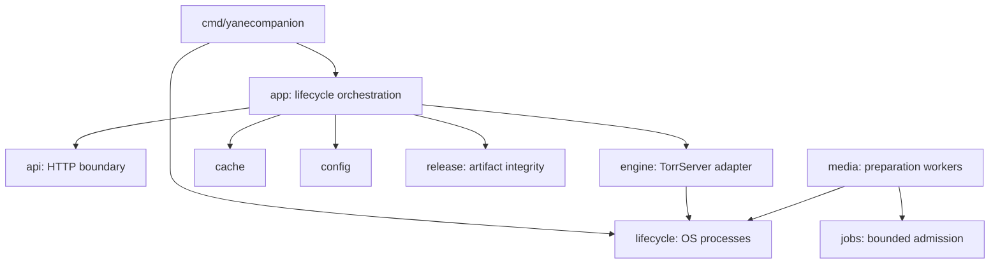

# yaneCompanion

Нативный локальный помощник yaneMedia. Host управляет отдельными TorrServer и
FFmpeg/ffprobe на устройстве зрителя. Пользовательский runtime не требует Node/Bun,
PostgreSQL, Docker или checkout исходников.

Сейчас реализуется **LC-003**: запуск процесса, локальный HTTP bootstrap, управление
дочерними процессами, ограниченные media jobs и восстановление собственного кэша.
Сопряжение, приём раздач, playback API, tray и установщики относятся к следующим
этапам. **Приём раздач закрыт**, capabilities playback не объявляются.

## Структура и зависимости

```text
cmd/
  yanecompanion/     точка входа: CLI, сигналы, process containment
  fetch-artifacts/   инструмент разработчика для проверки и загрузки sources
internal/
  app/              порядок запуска, остановки и локальные команды
  api/              HTTP boundary; не запускает engine или FFmpeg
  config/           пользовательские paths и права доступа
  lifecycle/        блокировка экземпляра и дочерние процессы для каждой ОС
  engine/           закрытый adapter TorrServer, admission gate
  media/            ограниченный worker runner и чистая timeline policy
  jobs/             одна активная и одна ожидающая работа на lane
  cache/            бюджет, свободное место и confined crash cleanup
release/            встроенный lock, проверка hashes, notices и build environment
build/              воспроизводимая сборка FFmpeg из подписанного source release
scripts/            команды сборки и подготовки development bundle
test/               сценарии готового runtime и Linux verification
```



`app` собирает компоненты, а `api` получает только необходимые данные и сигнал
остановки. Engine adapter не знает о HTTP-клиентах сайта. Media runner принимает
структурированные аргументы через отдельные `Probe`/`Prepare` и использует tools,
переданные после проверки bundle; универсального command,
filesystem или proxy endpoint нет. Общие интерфейсы вводятся при появлении
реального второго adapter, без отдельного framework/DI container.

## Запуск development bundle

В папке `dist/windows-amd64` находятся `yanecompanion.exe`, `tools/`, `sources/`,
`licenses/` и lock manifest. Это неподписанный bundle для разработки, не установщик.

```powershell
.\yanecompanion.exe run
.\yanecompanion.exe status
.\yanecompanion.exe exit
```

Linux: те же команды через `./yanecompanion`. Запускать от обычного пользователя.
Расположение bundle может отличаться от текущего каталога: tools ищутся рядом с
host executable и проверяются по встроенным SHA-256 перед запуском.

Host слушает только `127.0.0.1:45723`. Повторный запуск возвращает `ALREADY_RUNNING`,
другой процесс на порту — `PORT_IN_USE`. `status` и `exit` используют отдельный
случайный local bearer из user-only state; сайт его не получает.

По умолчанию ни один сайт не разрешён. Явный development opt-in:

```powershell
.\yanecompanion.exe run --origin https://watch.example
```

Этот origin — пример. Доступен только `GET /hello` с exact Origin/Host, no-store и
пустыми capabilities. Pairing/controllers/sessions ещё не реализованы.

## Пользовательские данные и завершение

Windows: state/config в `%LOCALAPPDATA%\yaneCompanion`, cache — в его `cache`.
Linux: `$XDG_CONFIG_HOME/yanecompanion`, `$XDG_STATE_HOME/yanecompanion`,
`$XDG_CACHE_HOME/yanecompanion`, со стандартными XDG defaults. Относительные roots
отклоняются. Windows directories получают наследуемую DACL текущего пользователя,
Linux directories — `0700`, файлы с секретами — `0600`.

Один instance блокирует state через OS lock. Windows host входит в Job Object
с `KILL_ON_JOB_CLOSE` **до** запуска children; Linux workers имеют process group и
parent-death signal, создающий OS thread сохраняется на весь срок worker.
Обычный exit сначала завершает workers, затем удаляет кэш. После crash следующая
загрузка удаляет только `run-<random>` с правильным `.owner` внутри cache root;
неизвестные файлы сохраняются, symlink escape не используется для удаления.

Engine cache — 256 MiB; общий disk cache — 2 GiB с резервом свободного места 1 GiB.
Host проверяет disk budget при старте и каждую секунду; превышение прекращает
runtime. Media runner ограничивает время и stdout/stderr; отдельно доступны одна
video preparation и один metadata job, по одной ожидающей работе. Это не измеренный
RAM/CPU budget. Полное управление rolling playback и его backpressure — LC-006/013.

## Сборка

Toolchain **Go 1.27.3**, dependency **golang.org/x/sys v0.49.0** (`go.mod`/`go.sum`).
URLs/SHA-256 исходников и готовых tools находятся в
[`release/dependencies.lock.json`](release/dependencies.lock.json). Зависимости
не обновляются при запуске приложения.

Windows development prerequisites: Go указанной версии, Docker для media build,
PowerShell и встроенный curl. Portable Go можно распаковать из проверенного
`artifacts/go1.27.3.windows-amd64.zip`; системная установка не требуется.

```powershell
.\scripts\fetch.ps1
.\scripts\media.ps1
.\scripts\build.ps1 -Target windows-amd64
.\scripts\assemble.ps1 -Target windows-amd64
```

Для cross-build использовать `-Target linux-amd64` в последних двух командах.
`-Go C:\path\to\go.exe` выбирает portable toolchain. Linux developer с Go 1.27.3
может скачать artifacts через `sh scripts/fetch.sh` и собрать host через
`sh scripts/build.sh`; Docker media recipe одинакова для обеих платформ.

FFmpeg/ffprobe собираются статически из подписанного release 9.0.2 с фиксированными
flags, compiler environment и Debian snapshot. Сборка проверяет подпись с pinned
fingerprint и сравнивает executables после повторной clean compilation.
Автоподключение внешних libraries, GPL/nonfree codecs и hardware acceleration
отключены. Эта конфигурация поддерживает probe, decode и AAC; production SDR video
encoding/4K/HDR acceptance и browser negotiation ещё не выполнены.

Host build: `CGO_ENABLED=0`, `GOAMD64=v1`, `GOTOOLCHAIN=local`, `-trimpath`,
`-buildvcs=false`, `-mod=readonly`, пустой build ID. Build manifest описывает
происхождение bundled tools; подписание/публикация updates — отдельный этап.
`scripts/reproducibility.ps1 -Go C:\path\to\go.exe` повторно собирает оба host
targets, сравнивает hashes и записывает `release/runtime-build.json`.

## Проверки и открытая приёмка

Focused packages: `internal/api`, `config`, `cache`, `engine`, `jobs`, `lifecycle`,
`media` и `test/runtime`. Для проверок готового bundle установить
`YANE_TEST_EXECUTABLE` в абсолютный путь к host. Без этой переменной соответствующие
тесты явно пропускаются, а не считаются проверкой настоящих binaries.

После сборки и assembly: `scripts/check.ps1 -Go C:\path\to\go.exe` на Windows
или `sh scripts/check.sh` на Linux. Проверки userspace Debian/Ubuntu/Arch из
Windows: `scripts/check-linux.ps1 -Go C:\path\to\go.exe`.
Эти scripts проверяют перечисленные пакеты и
целостность зафиксированного Go module, не запускают проверки yaneMedia.

Прогоны runtime проверяют cold start/restart, busy port, crash recovery и работу
вне checkout. Lifecycle test принудительно завершает отдельный host с настоящим
FFmpeg и проверяет отсутствие orphan. Media test кодирует PCM в AAC, probe/decode
проверяет результат и отменяет работающий FFmpeg. Unit tests проверяют HTTP boundary,
queue saturation/cancel, lock, cleanup, XDG и измеренные timeline anchors.

Текущая матрица и границы доказательств находятся в
[`docs/verification.md`](docs/verification.md). Контейнерные Linux-проверки не
заменяют native desktop/install/tray acceptance.

До website admission требуется доказать tracker/peer/DHT egress на каждой ОС.
Штатный peer blocklist TorrServer не считается такой защитой; текущий adapter
безусловно возвращает `UNSUPPORTED_CAPABILITY` для admission.
Кроме того, stock MatriX.148 допускает raw playback уже добавленной раздачи по
известному hash без Basic auth: это отдельный незакрытый gate LC-004. Проверка
`401` для неизвестного hash при startup не доказывает защиту активного потока.

Лицензии и требования перед публикацией: [THIRD_PARTY_NOTICES.md](THIRD_PARTY_NOTICES.md).
