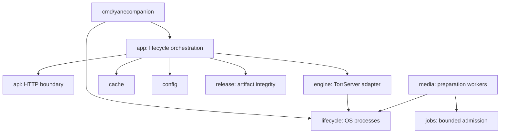

# yaneCompanion

## Desktop и установка (LC-010)

По умолчанию `yanecompanion` открывает native окно и трей. Код подключения
подтверждается в окне приложения; browser management и CLI остаются средствами
разработки. Windows x64 `.exe`, Debian/Ubuntu `.deb`, Arch `.pkg.tar.zst` и
AUR recipe собираются со всеми runtime tools. Пакеты пока не опубликованы и
не подписаны владельцем; LC-010 ожидает проверки и приёмки.

Пользовательский путь, build/signing команды и границы платформенной проверки —
[установка](docs/installation.md). Существующие инструкции `run`/`manage` ниже
относятся к development-проверкам.

Локальная программа для yaneMedia, которую зритель будет запускать на своём
компьютере. Наш код управляет готовыми инструментами: TorrServer отвечает за
BitTorrent, FFmpeg/ffprobe — за обработку и определение формата видео и звука.
Пользователю не потребуется устанавливать Node/Bun, PostgreSQL, Docker или исходники.

Сейчас подготовлена основа **LC-003**: запуск и остановка программы, один работающий
экземпляр, локальный HTTP-интерфейс, управление вспомогательными процессами,
ограниченные задачи обработки медиа и очистка временных файлов после сбоя.
LC-003 принят и закрыт 2026-11-05; код опубликован в `0c8d2b8`. По согласованию с
пользователем обязательные native-проверки целевых ОС перенесены в LC-014.
В **LC-004** добавлены сопряжение с сайтом, локальное подтверждение и отзыв доступа;
этап принят пользователем и закрыт 2026-11-05 после ручной проверки; коммиты
`yaneMedia 1c71769` / `yaneCompanion 505cc0d` проверены.
В **LC-005** реализованы отдельный metadata discovery на сайте, validated locators,
controller leases и локальный приём раздачи с выбором файла. Этап принят пользователем
и закрыт 2026-11-06; проверены коммиты `yaneMedia 9c2d4b9` / `yaneCompanion f2a8772`.
В **LC-006** реализованы probe/configure, непрерывный локальный HLS, измеренная
шкала времени, отдельные read grants и ограниченный кэш. Focused проверки и один
независимый tester завершены с PASS; этап принят и закрыт 2026-11-06, коммит `c3fe04a` проверен.
В **LC-007** добавлены описания и выбор озвучек, локальная подготовка SRT/WebVTT/ASS,
sidecars и вложенных TTF/OTF. Проверки и границы — в [verification](docs/verification.md).
Один независимый tester и focused повторные проверки завершены с PASS.
Пользовательская приёмка и коммит LC-007 ещё предстоят.
Подключение к обычной странице — LC-008; значок в трее и установщики — LC-010.
**Локальная загрузка доступна в Public; воспроизведение ещё не подключено.**

## Как ориентироваться в папках

| Где                                       | Что там находится                                                                                        |
| ----------------------------------------- | -------------------------------------------------------------------------------------------------------- |
| `cmd/yanecompanion/`                      | Вход в программу: принимает команды запуска, проверки состояния и выхода.                                |
| `internal/`                               | Основной код помощника: общение с сайтом, управление TorrServer/FFmpeg, очередями, файлами и процессами. |
| `test/` и файлы `*_test.go` рядом с кодом | Автоматические проверки отдельных функций и готовой программы.                                           |
| `build/` и `scripts/`                     | Инструкции и команды для разработчика: скачать зависимости, собрать и проверить программу.               |
| `release/`                                | Зафиксированные версии компонентов, проверка их целостности, сведения о сборке и лицензии.               |
| `docs/`                                   | Результаты проверок и ещё не выполненные условия приёмки.                                                |
| `.tools/` и `artifacts/`                  | Локальные инструменты сборки, кэши и скачанные зависимости. В Git не входят.                             |
| `dist/`                                   | Собранная программа с необходимыми компонентами отдельно для Windows и Linux. В Git не входит.           |

Начинать знакомство достаточно с этого README. Для чтения кода следующий маршрут:
`cmd/yanecompanion/main.go` → `internal/app/app.go` → нужный модуль в `internal/`.
Файлы с окончаниями `_windows.go` и `_linux.go` содержат различия между ОС;
при сборке Go выбирает подходящий вариант.

Ниже находятся подробности для разработки и проверки помощника.

## Подробная структура и зависимости

```text
cmd/
  yanecompanion/     точка входа: CLI, сигналы, process containment
  fetch-artifacts/   инструмент разработчика для проверки и загрузки sources
internal/
  app/              порядок запуска, остановки и локальные команды
  api/              HTTP boundary; не запускает engine или FFmpeg
  pairing/          подтверждение подключения, сроки запросов и сохранённые verifiers
  locator/          проверка magnet/.torrent и peer metadata до открытия storage
  sessions/         владельцы вкладок, lease, operations и ограниченная загрузка
  config/           пользовательские paths и права доступа
  lifecycle/        блокировка экземпляра и дочерние процессы для каждой ОС
  engine/           закрытый adapter TorrServer; только проверенный ввод
  media/            ограниченный worker runner и чистая timeline policy
  jobs/             одна активная и одна ожидающая работа на lane
  cache/            бюджет, свободное место и confined crash cleanup
release/            встроенный lock, проверка hashes, notices и build environment
build/              воспроизводимая сборка FFmpeg из подписанного source release
scripts/            команды сборки и подготовки development bundle
test/               сценарии готового runtime и Linux verification
```



`app` собирает компоненты, а `api` получает только необходимые данные и сигнал
остановки. Engine adapter не знает о HTTP-клиентах сайта. Media runner принимает
структурированные аргументы через отдельные `Probe`/`Prepare` и использует tools,
переданные после проверки bundle; универсального command,
filesystem или proxy endpoint нет. Общие интерфейсы вводятся при появлении
реального второго adapter, без отдельного framework/DI container.

## Запуск development bundle

В папке `dist/windows-amd64` находятся `yanecompanion.exe`, `tools/`, `sources/`,
`licenses/` и lock manifest. Это неподписанный bundle для разработки, не установщик.

```powershell
.\yanecompanion.exe run
.\yanecompanion.exe status
.\yanecompanion.exe exit
```

Linux: те же команды через `./yanecompanion`. Запускать от обычного пользователя.
Расположение bundle может отличаться от текущего каталога: tools ищутся рядом с
host executable и проверяются по встроенным SHA-256 перед запуском.

Host слушает только `127.0.0.1:45723`. Повторный запуск возвращает `ALREADY_RUNNING`,
другой процесс на порту — `PORT_IN_USE`. `status` и `exit` используют отдельный
случайный local bearer из user-only state; сайт его не получает.

По умолчанию ни один сайт не разрешён. Явный development opt-in:

```powershell
.\yanecompanion.exe run --origin https://watch.example
```

Этот origin — пример, production allowlist пока не задан. Для другого домена
перезапустите helper с его exact HTTPS origin и выполните новое сопряжение.
`GET /hello` проверяет exact Origin/Host и объявляет `pairing.v1`,
`torrent-admission.v1`, `torrent-files.v1`, `sessions.v1`, `hls.mse`,
`timeline.windowed-vod`, `video.original`, `audio.aac`, `audio.select`,
`text.prepared`, `text.ass`, `text.sidecars`, `text.fonts`.

Для текущего локального yaneMedia доступен отдельный opt-in:

```powershell
.\yanecompanion.exe run --dev-origin http://localhost:5173
```

`--dev-origin` принимает только exact HTTP origin с host `localhost`, `127.0.0.1`
или `[::1]`; порт входит в проверку. Флаг не используется вместе с `--origin`.
Другие HTTP hosts, LAN IP, userinfo, wildcard, path, query и fragment отклоняются.
Обычный HTTPS allowlist не принимает HTTP. Dev-флаг разрешает локальную проверку
без сертификатов; публичная HTTPS/LNA приёмка остаётся отдельной.

На сайте нажмите «Локальный помощник» → «Подключить». Затем откройте локальное управление:

```powershell
.\yanecompanion.exe manage
```

Сравните адрес сайта и шестизначный код в обоих окнах, нажмите «Разрешить» в окне
помощника. Там же можно отклонить запрос или отозвать сохранённый доступ. Для
development на Linux команда `./yanecompanion manage` использует `xdg-open` в desktop
сессии. Этот запуск управления не заменяет будущий tray launcher LC-010.

Запрос живёт 120 секунд, одновременно ожидает один запрос, разрешены до пяти
запросов в минуту. Browser хранит grant в IndexedDB только текущего origin/profile;
helper сохраняет только SHA-256 verifier в user-only `pairings.json`. Новый boot
сохраняет pairing. Токен аккаунта/cookies сайта помощнику не передаются.
Management UI использует отдельный пятиминутный proof и собственный Origin, закрыт
от CORS/framing; URL fragment с proof сразу удаляется. Повторная команда `manage`
инвалидирует прежний proof. CLI bearer не попадает в страницу.

Сайт различает несовместимую версию, известный browser permission denial и общий
сбой подключения. Сопряжение доступно гостям; само подключение не запускает раздачи.
`torrent-admission.v1` и `torrent-files.v1`
разрешают отдельный явный выбор; `sessions.v1`/media capabilities ещё не объявлены.

### Ручная приёмка LC-005

Запустите Public-конфигурацию yaneMedia (`VITE_SERVER_TORRENT_ENABLED=false`),
оставив server streaming выключенным. Backend использует настройки JSON API
JacRed/Knaben из своего env; при отсутствии источников доступен ручной ввод.
Для локального Public preview с портом 5174 запустите helper:

```powershell
.\yanecompanion.exe run --dev-origin http://localhost:5174
```

Откройте произведение → меню источника → «Торренты». Подключите помощник обычным
способом и подтвердите код через `manage`. «Найти раздачи» не создаёт серверную
сессию; выбранный candidate передаётся helper после отдельного resolve на 120 s.
Ручные magnet и `.torrent` уходят только в helper, без backend upload. Выберите
видео из списка: текущая версия получает ограниченный префикс до 1 MiB и показывает
количество байтов. Этот UI пока использует только LC-005; API media source добавлен
в LC-006, подключение к обычной странице относится к LC-008.
«Остановить загрузку», отзыв доступа, уход со страницы или смена аккаунта закрывают
controller; пропавшая вкладка ограничена lease 180 s. Каждая вкладка имеет своего
владельца, второе одновременное открытие получает `DEVICE_BUSY`.

Ввод: magnet до 4 KiB/20 trackers, .torrent до 2 MiB, 500 files/200 GiB;
symlink/webseed/traversal/collisions и неподдержанные features отклоняются.
Helper передаёт движку только проверенный locator. Для magnet тот же валидатор
встроен в patched engine и проверяет peer info dictionary перед storage.

Focused проверки: `go test ./internal/locator ./internal/sessions ./internal/api
./internal/pairing ./internal/engine ./internal/app`; для bundled raw-auth test
укажите `YANE_TEST_EXECUTABLE`. Настоящие `.torrent` и cold-magnet transfers можно
повторить без Internet egress после `scripts/engine.ps1`:

```powershell
.\scripts\check-swarm.ps1 -Go .\.tools\go\bin\go.exe -EngineSource <server directory from engine.ps1>
```

Это отдельная internal Docker-сеть с сидером и неизменённым production engine:
префикс ровно 1 MiB из fixture 2 MiB. Synthetic public IPv4 и client /32 существуют
только внутри тестовой сети; production flags/guard не меняются. Скрипт удаляет
свои containers/network. Проверяются `.torrent`, cold HTTP magnet и cold UDP magnet.
В MatriX.148-companion.4 публичный Sintel также передал по 1 MiB через `.torrent`
и cold UDP magnet. Ubuntu HTTP tracker возвращает единственного пира, который
объявляет доступным кусок из середины ISO; начальный префикс за 120 s не получен.

### Ручная приёмка LC-004 на Windows

Сборка уже находится в `dist/windows-amd64`. Запустите помощник в одном PowerShell:

```powershell
Set-Location "$env:USERPROFILE\yaneCompanion\dist\windows-amd64"
.\yanecompanion.exe run --dev-origin http://localhost:5173
```

Во втором PowerShell откройте локальное управление:

```powershell
Set-Location "$env:USERPROFILE\yaneCompanion\dist\windows-amd64"
.\yanecompanion.exe manage
```

Откройте `http://localhost:5173`, обновите страницу и проверьте:

1. «Локальный помощник» → «Подключить» показывает код. В локальном управлении тот
   же код и exact адрес сайта. «Разрешить» даёт сообщение об успешном подключении;
   сообщение об отсутствии локального просмотра сейчас ожидаемо.
2. После обновления страницы «Проверить подключение» подтверждает сохранённый доступ
   без нового кода. То же после `yanecompanion.exe exit` и повторного `run` с тем же флагом.
3. «Отключить и отозвать доступ» удаляет подключение. Следующая попытка требует
   нового локального подтверждения.
4. «Отклонить» в помощнике даёт сообщение об отказе; «Отменить» на сайте убирает
   ожидающий запрос из локального управления.
5. После `yanecompanion.exe exit` подключение сообщает о недоступности помощника.

Локальное окно управления действует 5 минут: при истечении снова выполните `manage`.
Лимит создания запросов — пять в минуту; при его достижении подождите минуту.
На телефоне/узком окне кнопка находится в меню мобильной шапки. Проверять playback
для LC-004 ещё не требуется.

## Локальный media API (LC-006)

Существующий Public file picker сохраняет ограниченную команду `select` из LC-005.
Новый путь: `probe` выбранного `fileRef` → metadata и свежие audio refs → `configure`
с полной target (`fileRef`, `audioRef`, `textRef: null`, `positionSeconds`,
`output: "original"`) и проверенными браузером `clientMedia` MIME/codecs.
Команды используют прежние UUID/replay/CAS/operation endpoints. Пока нет готового
probe, configure возвращает `PROBE_REQUIRED`; неподдержанный формат или MIME —
`UNSUPPORTED_MEDIA`, без скрытой смены качества или server fallback.

`ready` возвращает `source` с id/revision, HLS URL, timeline, available ranges,
описанием фактического video/audio output и количеством байтов кэша. Video H.264/
HEVC сохраняет исходные resolution/bit depth/HDR; браузер должен подтвердить MIME.
Совместимый AAC/AC-3/E-AC-3 копируется, при необходимости звук отдельно преобразуется
в AAC stereo. Сейчас объявлен только `original`: SDR video encoding, 4K transcode,
HDR→SDR, hardware acceleration и субтитры не объявляются реализованными.

Один FFmpeg muxer пишет fMP4 в ограниченный pipe. Host проверяет размеры боксов и
измеряет fragment clocks, публикует HLS с fragment durations до 3 s. Сегменты не
обязаны начинаться с keyframe: непрерывная декодирующая цепочка сохраняется,
новый host seek запускает новый source с исходного keyframe. HLS не объявляет
`INDEPENDENT-SEGMENTS`. Шкала `absoluteAnchor + currentTime - mediaAnchor` использует
реальный первый packet PTS и decode/presentation offset, а не requested seek.

Подготовка ограничена окном 8–45 s плюс один fragment и byte-aware cache: цель
48 MiB, жёсткий предел 128 MiB, один fragment до 64 MiB. Pipe останавливает
production при паузе независимо от input buffering. Просмотренная часть удаляется
только по подтверждённой позиции; открытый HTTP response удерживает свой файл.
Начальная decoder chain сохраняется до первого подтверждения. Если byte pressure
наступает раньше стартовых 6 s, ready использует реально доступный префикс; если
бюджет не позволяет подготовить requested seek, возвращается `RESOURCE_LIMIT`.
`POST /v1/sessions/{id}/progress` с controller bearer, `sourceRevision` и
`positionSeconds` подтверждает позицию внутри подготовленных ranges, без продления
lease. Download/media GET не считаются просмотром. ENDLIST появляется только после
успешного абсолютного EOF; source revision не меняется при обычном продолжении.

Media GET/HEAD доступны только по отдельному random read grant, exact Origin/Host,
без Authorization/Cookie/Range и redirect. Grant не даёт control, raw torrent или
filesystem access; revoke/lease/stop/replacement сразу его закрывают. Preparation
и её children отменяются до engine Drop. Worker input — отдельный private loopback
bridge с exact authenticated 256 KiB ranges; engine password/URL не передаются
FFmpeg или браузеру. Для metadata ограничение input 32 MiB и stdout 1 MiB;
network/secondary playlists/file protocols и произвольные URL запрещены.

Проверка готовых media tools: `YANE_TEST_EXECUTABLE=<absolute bundle executable>`
и `go test ./internal/media ./internal/api ./internal/sessions`. Для настоящей
раздачи дополнительно задайте `YANE_TEST_TORRENT=<validated local .torrent>` и
запустите `go test ./internal/media -run TestTorrentMedia -v`.
Результаты и непроверенные условия — [verification](docs/verification.md).

## Пользовательские данные и завершение

Windows: state/config в `%LOCALAPPDATA%\yaneCompanion`, cache — в его `cache`.
Linux: `$XDG_CONFIG_HOME/yanecompanion`, `$XDG_STATE_HOME/yanecompanion`,
`$XDG_CACHE_HOME/yanecompanion`, со стандартными XDG defaults. Относительные roots
отклоняются. Windows directories получают наследуемую DACL текущего пользователя,
Linux directories — `0700`, файлы с секретами — `0600`.

Один instance блокирует state через OS lock. Windows host входит в Job Object
с `KILL_ON_JOB_CLOSE` **до** запуска children; Linux workers имеют process group и
parent-death signal, создающий OS thread сохраняется на весь срок worker.
Обычный exit сначала завершает workers, затем удаляет кэш. После crash следующая
загрузка удаляет только `run-<random>` с правильным `.owner` внутри cache root;
неизвестные файлы сохраняются, symlink escape не используется для удаления.

Engine cache — 256 MiB; общий disk cache — 2 GiB с резервом свободного места 1 GiB.
Host проверяет disk budget при старте и каждую секунду; превышение прекращает
runtime. Media runner ограничивает время и stdout/stderr; отдельно доступны одна
video preparation и один metadata job, по одной ожидающей работе. Это не измеренный
RAM/CPU budget. В LC-006 preparation использует backpressure ниже; измерение
общих RAM/CPU budgets и расширенное восстановление относятся к LC-013.

## Сборка

Toolchain **Go 1.27.3**, dependency **golang.org/x/sys v0.49.0** (`go.mod`/`go.sum`).
URLs/SHA-256 исходников и готовых tools находятся в
[`release/dependencies.lock.json`](release/dependencies.lock.json). Зависимости
не обновляются при запуске приложения.

Windows development prerequisites: Go указанной версии, Docker для media build,
PowerShell и встроенный curl. Portable Go можно распаковать из проверенного
`artifacts/go1.27.3.windows-amd64.zip`; системная установка не требуется.

```powershell
.\scripts\fetch.ps1
.\scripts\engine.ps1 -Go .tools\go\bin\go.exe
.\scripts\media.ps1
.\scripts\build.ps1 -Target windows-amd64
.\scripts\assemble.ps1 -Target windows-amd64
```

Для cross-build использовать `-Target linux-amd64` в последних двух командах.
`-Go C:\path\to\go.exe` выбирает portable toolchain. Linux developer с Go 1.27.3
может скачать artifacts через `sh scripts/fetch.sh`, собрать engine через
`sh scripts/engine.sh` и host через `sh scripts/build.sh`; Docker media recipe
одинакова для обеих платформ.

Engine — **MatriX.148-companion.4**, сборка из закреплённого MatriX.148, без GST.
`cmd/patch-engine` применяет небольшие изменения с проверкой контекста к upstream
и его `tsynik/torrent v1.2.34`, не изменяя module cache. SHA-256 источников, patch
recipe/policy и готовых binaries находятся в lock; `go mod verify` проверяет
извлечённые зависимости перед копированием. Bundle содержит corresponding patch
sources и recipe в `sources/companion-engine/`. Повторные сборки обоих engine
targets совпали; сведения — в `release/engine-build.json`.

FFmpeg/ffprobe собираются статически из подписанного release 9.0.2 с фиксированными
flags, compiler environment и Debian snapshot. Сборка проверяет подпись с pinned
fingerprint и сравнивает executables после повторной clean compilation.
Автоподключение внешних libraries, GPL/nonfree codecs и hardware acceleration
отключены. Эта конфигурация поддерживает probe, decode и AAC; production SDR video
encoding/4K/HDR acceptance и browser negotiation ещё не выполнены.

Host build: `CGO_ENABLED=0`, `GOAMD64=v1`, `GOTOOLCHAIN=local`, `-trimpath`,
`-buildvcs=false`, `-mod=readonly`, пустой build ID. Build manifest описывает
происхождение bundled tools; подписание/публикация updates — отдельный этап.
`scripts/reproducibility.ps1 -Go C:\path\to\go.exe` повторно собирает оба host
targets, сравнивает hashes и записывает `release/runtime-build.json`.

## Проверки и открытая приёмка

Focused packages: `internal/api`, `config`, `cache`, `engine`, `jobs`, `lifecycle`,
`media` и `test/runtime`. Для проверок готового bundle установить
`YANE_TEST_EXECUTABLE` в абсолютный путь к host. Без этой переменной соответствующие
тесты явно пропускаются, а не считаются проверкой настоящих binaries.

После сборки и assembly: `scripts/check.ps1 -Go C:\path\to\go.exe` на Windows
или `sh scripts/check.sh` на Linux. Проверки userspace Debian/Ubuntu/Arch из
Windows: `scripts/check-linux.ps1 -Go C:\path\to\go.exe`.
Эти scripts проверяют перечисленные пакеты и
целостность зафиксированного Go module, не запускают проверки yaneMedia.

Прогоны runtime проверяют cold start/restart, busy port, crash recovery и работу
вне checkout. Lifecycle test принудительно завершает отдельный host с настоящим
FFmpeg и проверяет отсутствие orphan. Media test кодирует PCM в AAC, probe/decode
проверяет результат и отменяет работающий FFmpeg. Unit tests проверяют HTTP boundary,
queue saturation/cancel, lock, cleanup, XDG и измеренные timeline anchors.

Текущая матрица и границы доказательств находятся в
[`docs/verification.md`](docs/verification.md). Контейнерные Linux-проверки не
заменяют native desktop/install/tray acceptance.
Проверки native Windows 11/Debian/Ubuntu/Arch обязательны в финальной приёмке LC-014;
закрытие LC-003 не присваивает им статус PASS.

В patched engine все raw HTTP routes требуют Basic auth, browser Origin запрещён.
Peer TCP, HTTP trackers и metadata HTTP проверяют фактический адрес после DNS перед
connect, в том числе при redirects. Разрешён публичный IPv4 TCP; special-purpose
адреса и локальные interface subnets запрещены. В `.4` UDP trackers используют
отдельный connected IPv4 socket с той же проверкой фактического адреса до первой
датаграммы и общим deadline 15 s, включая DNS/connect/announce. Ответы принимаются
только от выбранного endpoint; отмена закрывает socket. Proxy из settings/env,
IPv6, DHT, uTP, PEX, local discovery и port mapping отключены принудительно.
Работа UDP tracker не гарантирует доступность TCP peers или metadata конкретной раздачи.

Focused проверки LC-004: `go test ./build/engine ./internal/api ./internal/pairing
./internal/app ./internal/engine`; для последнего нужен `YANE_TEST_EXECUTABLE`.
`scripts/engine.ps1` дополнительно проверяет реальные peer/tracker hooks upstream
и невозможность включить DHT/uTP/proxy настройками. LC-005 добавляет отдельные
локальные sessions/controllers, без playback/media capabilities.

Лицензии и требования перед публикацией: [THIRD_PARTY_NOTICES.md](THIRD_PARTY_NOTICES.md).
